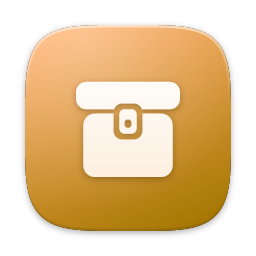

# Glazr Zip

Free archive manager for **macOS** and **Windows** by [IGY Apps](https://igy-apps.com).
Open, extract and create ZIP, 7z, TAR and more; extract RAR, ISO and split archives.

- **Arabic file names done right.** ZIP files made on older Arabic Windows often show names
  like `ãÑÍÈÇ.txt` in other programs. Glazr Zip reads them correctly, shows you the names
  before extracting, and can repair folders that were already extracted with broken names.
- "Extract here", "Extract to a folder" and "Compress to ZIP" in the right-click menu.
- Smart extraction: never a folder inside a folder. AES-256 passwords, split archives, archive test.
- Safe: nothing is written outside the folder you choose, extracted files are never run, and
  files from downloaded archives keep the system's "downloaded from the internet" protection.
- Free, no trial, no nag screens. Works **offline**. Arabic, English, French and German.

## Download

| System | Where |
|---|---|
| macOS 12 or newer, Apple Silicon (M1 or newer) | **[Releases](https://github.com/islammohy/glazr-zip/releases/latest)**: `Glazr-Zip-<version>-macOS-arm64.dmg` |
| Windows 10/11 | Coming to the **[Microsoft Store](https://apps.microsoft.com/detail/9NDX5FGZHH20)** |

Open the `.dmg` and drag Glazr Zip to Applications. The app is signed with a Developer ID and
notarized by Apple. Intel Macs are not supported in this version. Check a download against
`SHA256SUMS.txt` in the same release if you like: `shasum -a 256 <file>`.

This repository holds downloads only. The application's source code is not public.

## Privacy

Your files never leave your computer. When online, the app downloads the banner and the
latest version number, sending only the app name, system, language and install source.
igy-apps.com keeps daily totals of these values and of banner clicks — no IP address and no
device or user identifier. Offline, the banner is a link to the website.
Full text: [PRIVACY.md](PRIVACY.md).

## Open-source parts

The app runs the official **7-Zip** console program by Igor Pavlov (GNU LGPL, with the unRAR
restriction: RAR archives are extracted, never created), and includes Qt/PySide6 (LGPLv3),
Lucide icons (ISC) and the IBM Plex Sans Arabic font (OFL). Their licenses are in the app's
`licenses` folder, together with the source code of the 7-Zip version it ships.

## Problems and ideas

Open an [issue](https://github.com/islammohy/glazr-zip/issues). Please don't attach private files.

---

# Glazr Zip بالعربية

برنامج مجاني لإدارة الأرشيفات على **ماك** و**ويندوز** من [IGY Apps](https://igy-apps.com):
افتح واستخرج وأنشئ ملفات ZIP و7z وTAR وغيرها، واستخرج RAR وISO والأرشيفات المقسّمة.

- **أسماء الملفات العربية صحيحة.** ملفات ZIP المصنوعة على ويندوز العربي القديم تظهر أسماؤها في
  البرامج الأخرى مثل «ãÑÍÈÇ». أما Glazr Zip فيقرؤها صحيحة، ويعرضها قبل الاستخراج، ويصلح حتى
  المجلدات التي استُخرجت من قبل بأسماء مشوّهة.
- «استخراج هنا» و«استخراج إلى مجلد» و«ضغط إلى ZIP» من قائمة الزر الأيمن.
- استخراج ذكي بلا «مجلد داخل مجلد»، وكلمات سر AES-256، وتقسيم الأرشيف، واختبار سلامته.
- آمن: لا يُكتب شيء خارج المجلد الذي تختاره، ولا يُشغَّل أي ملف مستخرَج.
- مجاني بلا فترة تجربة وبلا نوافذ مزعجة، ويعمل **بدون إنترنت**.

**التنزيل لماك:** من صفحة [الإصدارات](https://github.com/islammohy/glazr-zip/releases/latest)، ملف `.dmg`
لأجهزة ماك بمعالج Apple ‏(M1 أو أحدث) ونظام macOS 12 أو أحدث. افتحه واسحب البرنامج إلى مجلد
التطبيقات؛ البرنامج موقّع ومعتمد من Apple. أجهزة Intel غير مدعومة في هذا الإصدار.

**ويندوز:** قريبًا من [متجر مايكروسوفت](https://apps.microsoft.com/detail/9NDX5FGZHH20).

